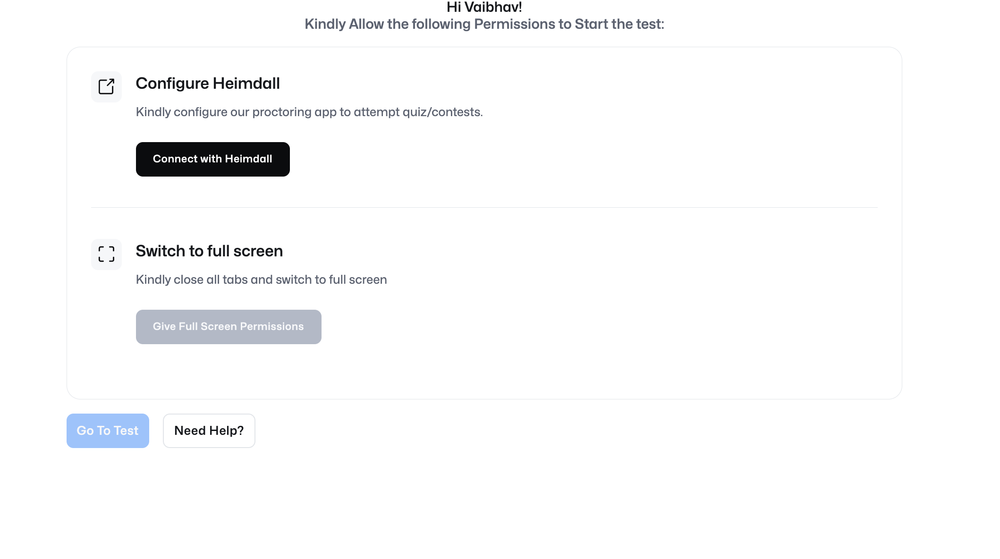

# 🏛️ Athena — Secure Proctored Exam Platform

<div align="center">



[](https://www.electronjs.org/)
[](https://react.dev/)
[](https://vitejs.dev/)
[](https://expressjs.com/)
[](#packaging--distribution)
[](#license)

**Athena** is a modern, high-integrity computer-based examination desktop application. Engineered with an Electron desktop shell, a React 19 single-page UI, and a decoupled Express API, it delivers seamless candidate evaluation with continuous background proctoring, native fullscreen enforcement, and tamper-resistant test delivery.

</div>

---

## 📑 Table of Contents

- [Key Features](#-key-features)
- [System Architecture](#-system-architecture)
- [Directory Structure](#-directory-structure)
- [Prerequisites](#-prerequisites)
- [Installation](#-installation)
- [Development Workflow](#-development-workflow)
- [Packaging & Distribution](#-packaging--distribution)
- [API Reference](#-api-reference)
- [Electron IPC Channels](#-electron-ipc-channels)
- [Customizing Questions](#-customizing-questions)
- [Anti-Cheat & Security Considerations](#-anti-cheat--security-considerations)
- [License](#-license)

---

## ✨ Key Features

- **🛡️ Automated Webcam Proctoring**: Periodically captures candidate snapshots during the exam via hardware webcam integration and securely archives them on the host system.
- **⏱️ Main-Process Synchronized Timer**: The exam stopwatch runs inside Electron's main process, communicating via asynchronous IPC to avoid renderer/browser throttling or timer tampering.
- **🔒 Zero-Knowledge Frontend**: The client interface never receives the correct answer keys. All answer validation and score aggregations are processed strictly server-side.
- **💻 Fullscreen Lockdown & Anti-Distraction**:
  - Fullscreen display verification prior to exam entry.
  - Native system rules dialog.
  - Context menu and keyboard shortcut restrictions.
- **🎨 Modern React 19 Candidate Experience**:
  - Real-time question navigation palette (Attempted, Current, Unanswered).
  - Floating Picture-in-Picture (PiP) video preview ensuring candidate posture visibility.
  - Instant question bookmarking, review, and celebratory confetti upon completion.
- **📦 Zero-Config Portable JSON Datastore**: Runs out of the box using isolated JSON data stores (`questions.json`, `sessions.json`), eliminating database setup overhead while supporting custom storage directories in production.

---

## 🏛 System Architecture

Athena employs a multi-tiered architecture that separates presentation, native operating system integration, and server-side evaluation:

```mermaid
graph TD
    subgraph Desktop Shell ["Electron Main Process (app/app.js)"]
        MP[Main Process Controller]
        Timer[IPC Timer Engine (1s tick)]
        Proctor[Proctoring Trigger (5s interval)]
        FS[Disk Storage: user-camera-snap/]
    end

    subgraph Security Boundary ["Secure Preload (app/preload.js)"]
        CB[contextBridge exposeInMainWorld]
    end

    subgraph Candidate UI ["React 19 Frontend (frontend/)"]
        Perm[Hardware & Rules Gate]
        ExamView[Exam Session & Question Palette]
        PiP[PiP Camera Monitor]
        Results[Scorecard & Confetti]
    end

    subgraph Backend Engine ["Express Server (backend/server.js)"]
        API[REST API :3000]
        QDB[(questions.json)]
        SDB[(sessions.json)]
    end

    MP -->|Loads| SecurityBoundary
    CB -->|Provides Secure API| Candidate UI
    Timer -->|IPC 'timer'| CB
    Proctor -->|IPC 'camera-shot'| CB
    Candidate UI -->|Snapshot binary| CB -->|store-camera-snap-image-on-disk| FS
    Candidate UI -->|REST: Start / Answer / Submit| API
    API -->|Read| QDB
    API -->|Read / Write| SDB
```

---

## 📂 Directory Structure

```text
Athena/
├── app/                      # Electron desktop shell
│   ├── app.js                # Main process (windowing, background backend, IPC)
│   ├── preload.js            # Secure ContextBridge API exposure
│   └── user-camera-snap/     # Local proctoring snapshot storage (.gitkeep)
│
├── backend/                  # Express REST backend
│   ├── data/
│   │   ├── questions.json    # Question bank (with correct answer indexes)
│   │   └── sessions.json     # Saved candidate sessions and score logs
│   ├── package.json          # Backend dependencies
│   ├── README.md             # Backend API guide
│   └── server.js             # Express API server implementation
│
├── frontend/                 # React 19 + Vite frontend
│   ├── public/               # Static assets & SVG icons
│   ├── src/
│   │   ├── assets/           # UI media
│   │   ├── services/
│   │   │   └── api.js        # Backend API client integration
│   │   ├── App.jsx           # Core examination flow & state machine
│   │   ├── App.css           # Styling and responsive layouts
│   │   ├── index.css         # Base resets and typography
│   │   └── main.jsx          # React DOM entrypoint
│   ├── index.html            # HTML shell
│   ├── package.json          # Frontend dependencies
│   └── vite.config.js        # Vite bundler configuration (outputs to ../dist)
│
├── .gitignore                # Git ignore configuration
├── package.json              # Monorepo/Root scripts & electron-builder packaging
└── README.md                 # Project documentation
```

---

## ⚙️ Prerequisites

Before running the application, make sure you have:

- **Node.js**: `v18.0.0` or higher (`v20+` recommended)
- **npm**: `v9.0.0` or higher
- A working **Webcam** (required for the proctoring check)

---

## 🚀 Installation

Clone the repository and install all dependencies:

```bash
# Clone the repository
git clone https://github.com/Akshuu1/AD-Desktop.git
cd AD-Desktop

# 1. Install root dependencies (Electron & electron-builder)
npm install

# 2. Install frontend dependencies (React & Vite)
cd frontend && npm install && cd ..

# 3. Install backend dependencies (Express & CORS)
cd backend && npm install && cd ..
```

---

## 🛠️ Development Workflow

To run the full stack in development mode:

### Step 1: Start the Backend Server
In your first terminal:
```bash
npm run backend
```
> The API server will start at `http://localhost:3000`.

### Step 2: Start the Frontend Dev Server
In your second terminal:
```bash
npm run dev
```
> The Vite development server will start at `http://localhost:5173`.

### Step 3: Launch the Electron Desktop Application
In your third terminal:
```bash
npm run electron
```
> Electron will launch and automatically load `http://localhost:5173` with live hot-reloading.

---

## 📦 Packaging & Distribution

Athena is pre-configured with **`electron-builder`** to generate standalone production binaries and macOS DMGs.

### 1. Build Frontend Distribution Assets
Compiles the React application into optimized static assets in the root `./dist` folder:
```bash
npm run build
```

### 2. Package as Directory (Fast Local Test)
Packs the Electron app into `./release/mac-arm64` without creating an installer:
```bash
npm run package:app
```

### 3. Generate macOS DMG Installer
Produces a production installer inside the `./release/` directory:
```bash
npm run build:dmg
```
> **Output:** `release/Athena-1.0.0-arm64.dmg`

*(Note: Target architecture can be updated in `package.json` under the `"build"` block for Windows or Linux targets).*

---

## 📡 API Reference

The backend operates on `http://localhost:3000`.

| Method | Endpoint | Description |
| :--- | :--- | :--- |
| `GET` | `/` | Health check verifying server status. |
| `POST` | `/exam/start` | Initializes a candidate session. Returns `sessionId`. |
| `GET` | `/exam/mcq` | Retrieves all test questions (strips out `correctAnswer`). |
| `GET` | `/exam/mcq/:id` | Retrieves a specific question by ID. |
| `POST` | `/exam/answer` | Submits an answer (`questionId`, `selectedAnswer`). Validates against answer key. |
| `GET` | `/exam/session/:sessionId` | Returns real-time metrics for an active session. |
| `POST` | `/exam/submit` | Finalizes exam session and returns candidate score summary. |

---

## 🔌 Electron IPC Channels

Communication between the Electron desktop shell and the React renderer is bridged securely through `preload.js`:

| IPC Event / Channel | Type | Origin | Purpose |
| :--- | :--- | :--- | :--- |
| `start-timer` | Invoke | Renderer $\rightarrow$ Main | Starts the exam stopwatch and camera capture intervals. |
| `timer` | Send | Main $\rightarrow$ Renderer | Emits elapsed time tick in seconds every 1000ms. |
| `camera-shot` | Send | Main $\rightarrow$ Renderer | Signals the renderer to grab a video frame every 5000ms. |
| `store-camera-snap-image-on-disk` | Invoke | Renderer $\rightarrow$ Main | Writes captured JPEG binary buffer to disk. |
| `show-rules` | Send | Renderer $\rightarrow$ Main | Triggers native OS alert modal outlining exam instructions. |

---

## 📝 Customizing Questions

To modify or add test questions, edit [`backend/data/questions.json`](file:///Users/BADMSOH/Downloads/Athena-Clone%202/backend/data/questions.json):

```json
[
  {
    "id": 1,
    "question": "Which Electron process is responsible for creating BrowserWindow?",
    "options": [
      "Renderer Process",
      "Main Process",
      "React Process",
      "Preload Process"
    ],
    "correctAnswer": 1
  }
]
```

- `id`: Unique integer identifier.
- `question`: Prompt text.
- `options`: Array of selectable choices.
- `correctAnswer`: Zero-indexed position of the correct choice (`0` = 1st option, `1` = 2nd option, etc.).

---

## 🛡️ Anti-Cheat & Security Considerations

1. **Context Isolation**: `contextIsolation: true` is enforced via Electron's ContextBridge. The renderer cannot execute arbitrary Node.js APIs or modify process memory.
2. **DevTools Lockdown**: DevTools are automatically deactivated when running packaged builds (`!app.isPackaged`).
3. **Session Immutability**: Once an exam session has been marked as submitted via `POST /exam/submit`, any further modifications or answer submissions for that `sessionId` are rejected.
4. **Offline Proctoring Trail**: Camera snapshots are timestamped and preserved in the application's secure user-data directory for post-exam review.

---

## 📄 License

This project is open source and available under the [MIT License](LICENSE).
